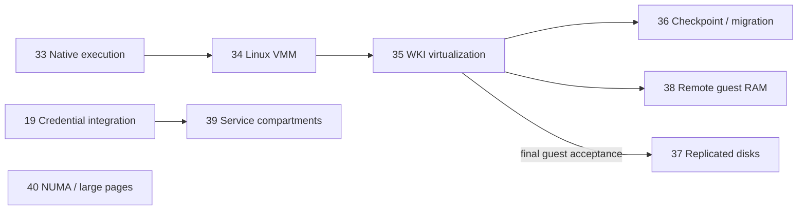

# Reconnaissance for goals 33–40

Reviewed against the local working tree on **2026-09-08**. This is planning
evidence, not implementation or a runtime audit. Existing goals 01–32 and their
completion records were preserved; the portfolio status table supplied selection
context without reopening completed work. The tree already contained extensive
kernel, userspace, test and libc edits, including in-progress credential work.
Executors must refresh this map against their actual starting tree.

## Goal-writing basis

OpenAI describes a goal as a bounded outcome with observable evidence,
preserved constraints, allowed scope, a feedback loop and a rule for handling
blockers. Those six elements are included in each new file, together with a
copyable activation prompt, prerequisites, checkpoints and one completion gate
requiring every acceptance criterion. See [Using Goals in Codex](https://developers.openai.com/cookbook/examples/codex/using_goals_in_codex)
and [Follow a goal](https://learn.chatgpt.com/use-cases/follow-goals).

These are new implementation contracts. Reading or writing them does not
activate a goal. Each is sized for **roughly 168–336 elapsed hours of continuous
primary-agent work with up to three bounded subagents active where useful**.
That is an ambitious planning estimate; low-level bring-up can take longer,
and runtime evidence depends on the user. No elapsed duration, token count,
number of subagents or unexecuted test script is a success condition. Finish
early if the complete evidence exists; do not stretch the work to fill a week.
No contract promises unattended kernel debugging or guaranteed multi-week
service availability.

## Why these eight goals

| Goal | Concrete improvement | Primary new engineering burden |
| --- | --- | --- |
| [33](33-native-hypervisor.md) | WOS itself executes isolated hardware guests | Intel VMX/EPT and AMD SVM/NPT, common ABI, state and memory ownership |
| [34](34-linux-guest-virtual-machine-monitor.md) | A useful Linux VM runs on WOS | libwosvirt, per-VM VMM, vmmd/vmctl, boot and virtio devices |
| [35](35-wki-distributed-virtualization.md) | WKI joins VM execution and remote devices into one platform | Authenticated VM control, stable identity, placement/admission and failure semantics |
| [36](36-wki-vm-checkpoint-migration.md) | Running VMs move between WOS systems | Complete state capture, dirty tracking, durable cutover and recovery |
| [37](37-wki-replicated-vm-volumes.md) | VM disks survive one storage-node failure | Durable quorum replication, fenced writers, snapshots and recovery |
| [38](38-wki-disaggregated-guest-memory.md) | A guest uses RAM capacity from several WOS systems | Bounded EPT/NPT cache, remote page ownership, eviction and fault progress |
| [39](39-isolated-service-compartments.md) | Native WOS services have independent process/mount/IPC views | Namespace-aware identity, pathwalk, child lifecycle and authority |
| [40](40-numa-memory-locality.md) | WOS uses multi-socket RAM and large pages safely | Firmware topology, placement policy and complete compound-page lifetime |

The six virtualization goals are a platform program, not six alternative
descriptions of the same deliverable. Goals 39–40 improve native WOS independently.

## Native virtualization map

Current source read:

- [CPU helpers](../modules/kern/src/platform/asm/cpu.hpp) expose CPUID, per-CPU
  state and XSAVE setup; [SMT initialization](../modules/kern/src/platform/smt/smt.cpp)
  calls CPU, descriptor, syscall, APIC and scheduler initialization.
- [Task](../modules/kern/src/platform/sched/task.hpp) owns saved execution and
  FPU state; [scheduler](../modules/kern/src/platform/sched/scheduler.hpp)
  owns per-CPU runqueues, waiters, accounting and reclamation.
- [VM interface](../modules/kern/src/platform/mm/virt.hpp),
  [VM implementation](../modules/kern/src/platform/mm/virt.opt.cpp),
  [paging](../modules/kern/src/platform/mm/paging.hpp) and
  [physical ownership](../modules/kern/src/platform/mm/phys.hpp) are the
  memory/pinning integration points. These are WOS address spaces, not a
  virtualization backend.
- [File objects](../modules/kern/src/vfs/file.hpp) and
  [resource accounting](../modules/kern/src/platform/sched/resource.hpp) supply
  lifecycle/charging constraints for new VM handles and RAM.
- [Virtio definitions](../modules/kern/src/dev/virtio/virtio.hpp) and the adjacent
  driver sources concern WOS as a virtual-device consumer.
- [Node setup](../scripts/cluster/node_setup.py) constructs outer QEMU arguments;
  its KVM acceleration does not mean WOS implements KVM.

A targeted kernel scan for VMXON, VMCS, VMLAUNCH, VMRUN, VMCB, SVM, EPT, NPT,
hypervisor and IOMMU found host-environment comments rather than a native
VM-execution implementation. This is evidence of a missing located backend, not
a proof about every external submodule. Goal 33 must confirm that finding.

The [Linux KVM API](https://www.kernel.org/doc/html/latest/virt/kvm/api.html)
separates system, VM and vCPU control through handles and capability queries.
That is an architectural reference for WOS, not a requirement for Linux binary
compatibility. The [Intel architecture manuals](https://www.intel.com/content/www/us/en/developer/articles/technical/intel-sdm.html)
are the execution-control reference for the Intel backend. AMD Architecture Programmer's Manual Volume 2 is listed
by the [AMD publisher](https://www.amd.com/en/developer/sev.html) for the SVM/NPT
backend; both vendors are now required by the revised contracts.
The [virtio 1.2 specification](https://docs.oasis-open.org/virtio/virtio/v1.2/virtio-v1.2.html)
defines the guest/device contract for goal 34; implement and advertise only a
documented subset.

## Revised two-vendor and userspace contract

The user expanded the support target to Intel and AMD. This revision supersedes
the initial Intel-only scope; all applicable VM acceptance matrices now require
both vendor backends. Each vendor has independent admission/control, state
restoration and second-level translation rules beneath one common WOS API.
Mixed-vendor WKI management and resources are required. Live migration is a
separate compatibility surface: require Intel→Intel and AMD→AMD, and reject
Intel↔AMD before cutover.

Read the [detailed architecture contract](VIRTUALIZATION-ARCHITECTURE.md) for
component ownership, proposed interfaces and the exact guest boot/run/device
flow. It adds `libwosvirt`, one `wos-vmm` process per VM, local `vmmd` supervision,
`vmctl`, a bounded guest Ethernet endpoint, and a typed userspace/WKI bridge.
These are proposed implementation surfaces, not discovered existing utilities.

Additional local checks found three integration constraints:

- [FileOperations](../modules/kern/src/vfs/file_operations.hpp) exposes ioctl and
  poll hooks but no generic device mmap hook. Start with checked run records;
  shared mapped run state requires explicit new lifetime support.
- [devfs](../modules/kern/src/vfs/fs/devfs.cpp) creates network statistics nodes
  whose write/ioctl handlers are null. A usable virtio-net host backend needs an
  actual packet endpoint and forwarding attachment, not those statistics nodes.
- [Userspace module rules](../modules/CMakeLists.txt) apply `-march=native`.
  New virtualization binaries and runtime dependencies need a declared supported
  ISA policy and validation on both vendors.

The Intel manual catalog, Linux boot protocol and KVM API were retrieved for
this refinement. AMD's catalog was retrieved but its linked Volume 2 download
failed. Subsequently, Intel SDM revision 092 and the user's saved AMD Volume 2
revision 3.45 (July 2026, 875 pages) were pinned and indexed with Docling in the
[local manual corpus](../docs/virtualization-manuals.md). Detailed vendor-control
validation remains implementation work against the original manuals.
No implementation or vendor hardware validation was performed.

## Distributed map and data flow

Read [wire.hpp](../modules/kern/src/net/wki/wire.hpp),
[wki.hpp](../modules/kern/src/net/wki/wki.hpp),
[wki.cpp](../modules/kern/src/net/wki/wki.cpp),
[remote compute API](../modules/kern/src/net/wki/remote_compute.hpp),
[authorization API](../modules/kern/src/net/wki/auth_policy.hpp),
[zones](../modules/kern/src/net/wki/zone.hpp),
[device server](../modules/kern/src/net/wki/dev_server.hpp),
[device proxy](../modules/kern/src/net/wki/dev_proxy.hpp),
[remotable resources](../modules/kern/src/net/wki/remotable.hpp),
[remote network](../modules/kern/src/net/wki/remote_net.hpp) and
[block devices](../modules/kern/src/dev/block_device.hpp).

Observed interfaces include `wki_init()`, reliable `wki_send()`,
`wki_remote_compute_admit_rx()`, `wki_try_remote_spawn()`,
`wki_dev_server_admit_detach_rx()`, `wki_dev_server_process_pending_detaches()`,
`wki_zone_create()`, and `block_read/write/flush()`.
Remote compute submits processes and binds work to channel/session identity;
VM identity and lifecycle must be a distinct service contract.
Zone APIs offer explicit transfers and local backing; they do not provide
hardware cache coherence between machines.

```text
WOS management client on A
  -> authenticated WKI VM request
  -> bounded admission and task-context executor worker on B
  -> userspace vmmd -> per-VM wos-vmm -> common kernel VM/vCPU
  -> Intel VMX/EPT or AMD SVM/NPT -> local physical CPU
                        |
                        +-> virtual disk/network -> WKI resource owner C
                        +-> guest page cache -> WKI RAM providers C/D (goal 38)

Migration: B -> prepared destination D -> fenced ownership commit -> D executes.
Replication: disk owner -> ordered durable majority -> guest durable completion.
```

Goals 35–38 require authenticated messages. Current `wki_init()` enables
secure-only v3 sessions and deliberately leaves raw RoCE disabled because it
bypasses authenticated records. Fast transport is optional until goal 25 or
equivalent code proves secure session-bound transfers. Authentication alone
does not establish confidentiality of guest RAM or disk bytes.

## Locks, ownership, contexts and compatibility

| Surface | Required preservation |
| --- | --- |
| Scheduler/VM entry | CPU-local hardware control state; complete host register/FPU restoration; bounded kick/preemption; no arbitrary guest execution under runqueue locks |
| RAM/EPT/NPT | Retained frame ownership; invalidation before reuse; synchronized emulated DMA and page eviction; no network waits under page/VM spinlocks |
| WKI RX | Peer/channel generation and authenticated identity; fixed bounded pre-ACK admission; blocking work deferred outside RX/NAPI |
| VM/device lifecycle | VM, task, FD, binding and queue references outlive operations; reset/incarnation rejects stale completions; teardown joins all users |
| Replication/migration | Authenticated transport is not quorum authority; partition never grants a second executor/writer; ambiguous commits have explicit unavailable states |
| ABI/wire | Capability negotiation, checked lengths, reserved-field policy, packed-layout assertions, mixed-version rejection, matching userspace wrappers |
| Diagnostics | Typed journal logging, stable utility ABI, counters safe in hot contexts; no guest data or host pointers exposed through routine diagnostics |

Exact lock ordering is intentionally not invented during portfolio drafting.
Each implementation must read both callers and callees and produce the required
patch contract before editing critical code.

## Native isolation and NUMA map

[Mount code](../modules/kern/src/vfs/mount.cpp) owns a global registry plus
`mount_lock`, generation and pivot epoch.
[Task](../modules/kern/src/platform/sched/task.hpp) has process root/cwd fields;
[lookup](../modules/kern/src/vfs/lookup.hpp) and
[VFS](../modules/kern/src/vfs/vfs.hpp) expose existing resolution contracts.
These support path confinement but are not independent process-owned mount
registries. Goal 39 adds scoped identity across mount, PID and named IPC
consumers, preserving explicit inherited capabilities and credential ceilings.

[SMT](../modules/kern/src/platform/smt/smt.cpp) builds a flat root/group CPU
topology in `init_cpu_domains()`.
[ACPI](../modules/kern/src/platform/acpi/acpi.cpp) has table access,
[physical allocation](../modules/kern/src/platform/mm/phys.hpp) has zones and
optional huge allocation, and [physical balance](../modules/kern/src/platform/mm/physical_balance.hpp)
requires exact owner accounting.
The current huge-leaf pin rejection and teardown skips in
[virt.opt.cpp](../modules/kern/src/platform/mm/virt.opt.cpp) make large-page
lifetime a prerequisite to exposing the expanded mapping policy in goal 40.

## Dependencies and ownership conflicts



Goal 37's storage implementation/model work can start independently; its final
guest test requires 35. Goal 40 has no hypervisor prerequisite. Goal 39 must
coordinate with the current credential work. Goal 25 is optional for every
new distributed goal; no new goal may activate unauthenticated RDMA.

Serialize shared edits across 33/36/38/40 (MM, EPT/NPT, Task), 35/36/37/38
(WKI wire, auth and lifecycle), and 39 with goals 19/26 (authority, pathwalk and
remote policy). Concurrent design/model/test subagents remain useful. Shared
headers, wire allocation and final integration have one owner. A model in
another directory is not permission for two agents to mutate the same kernel
contract simultaneously.

## Build, test and unknowns

- [Build WOS task](../.vscode/tasks.json) invokes
  `scripts/dev/build_wos.sh` with the configured WOS toolchain environment.
  Use that task or mirror its current command/environment if unavailable.
- [Host tests](../tests/host/CMakeLists.txt) register executable models and tests;
  [semantic regression](../scripts/test/semantic_regression.py) and
  [fault block device](../modules/kern/src/test/fault_block_device.hpp) are
  existing validation entrypoints. Proposed VM test binaries do not yet exist.
- Isolated KTEST uses `bin/wos-ktest --build-only` for build preparation.
  The user runs actual kernel/cluster fixtures and supplies logs. Do not turn
  the rootless launcher option into inferred permission to run debugging.
- User evidence is needed for VMX and SVM availability/firmware enablement or nested
  exposure, interrupt restoration, real SMP guests, multi-host WKI latency,
  physical disk durability, partitions/reboots, real NUMA distances and the
  stated performance gates. Host models cannot establish those facts.
- Guest artifacts need pinned versions/configuration/hashes. Copyable runtime
  commands must be supplied once the fixture and executable actually exist.
  No performance or runtime success is claimed by this investigation.

## Confirmed stale guidance

1. [WKI instructions](../.github/instructions/wki.instructions.md) still list
   `WKI_ETH_MAX_PAYLOAD = 8954`. Current
   [wire.hpp](../modules/kern/src/net/wki/wire.hpp) subtracts a 40-byte
   authentication trailer: the payload limit is **8914**.
2. Those instructions describe RoCE in the initialization sequence. Current
   [wki_init()](../modules/kern/src/net/wki/wki.cpp) deliberately omits raw
   RoCE initialization until its session authentication is implemented.
3. The pre-existing goal index said agents could perform rootless runtime
   debugging with `--no-setup`. The current user-supplied instructions require
   user-run debugging. The index rule was corrected while retaining existing
   goal statuses and unrelated edits.

No completed goal was re-audited, and no unrelated instruction/cache file was
rewritten. This document records the conflicts so future executors do not
inherit the wrong assumptions.
